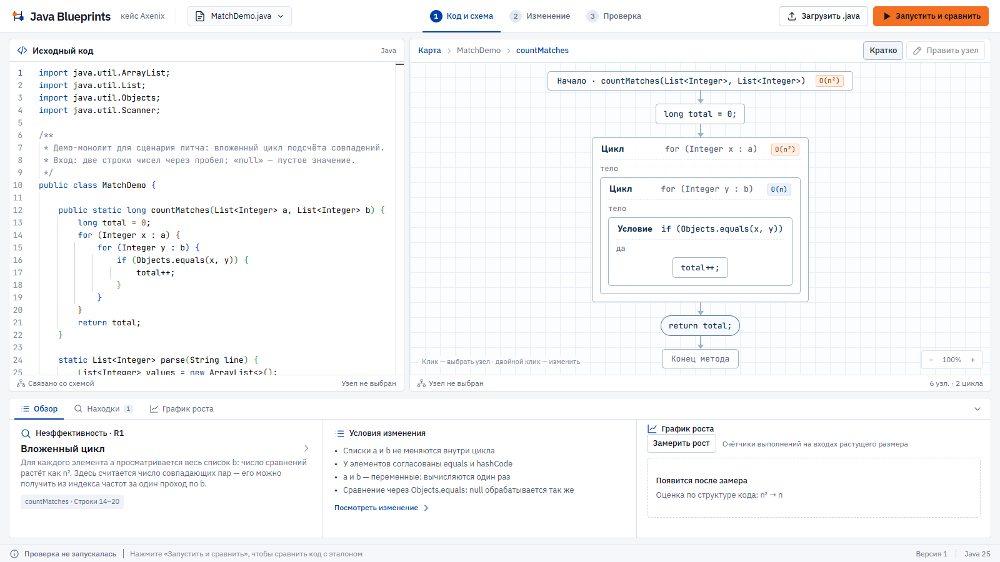
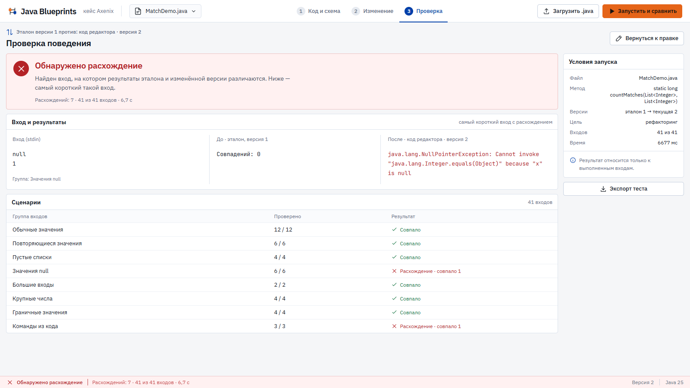
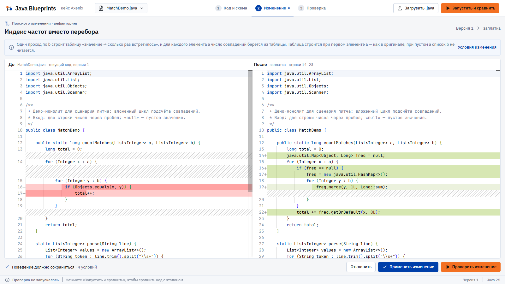
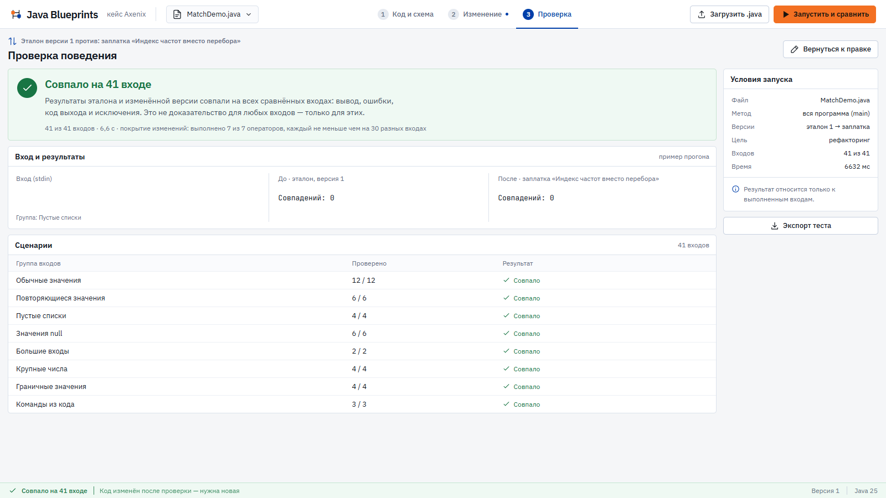
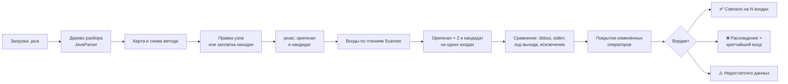

# Java Blueprints — код и схема

[](https://github.com/Roclabd/hackaton2026/actions/workflows/ci.yml)

Локальный веб-инструмент для Java-монолита: показывает программу как код и как схему, находит неэффективности и вероятные дефекты, предлагает исправление и запуском проверяет, что поведение не изменилось. Кейс Axenix, «Хакатон Осень 2026».

[Запуск](#запуск) · [Сценарий демо](#сценарий-демо) · [Как проверяется поведение](#как-проверяется-поведение) · [Что поддержано](#что-поддержано) · [Ограничения](#ограничения)



| Результат прогона на `MatchDemo.java` | Источник |
|---|---|
| Заплатка вложенного цикла: **совпало на 41 из 41 входа**; рост n² → n, при n = 1600 тело цикла выполнилось **2 561 600 → 3 200** раз | [SCOPE.md](docs/SCOPE.md#сквозная-проверка-jar), тесты [`ChangedCoverageGateTest`](backend/src/test/java/blueprints/gate/ChangedCoverageGateTest.java), [`GrowthProfilerTest`](backend/src/test/java/blueprints/profile/GrowthProfilerTest.java) |
| Правка `Objects.equals(x, y)` → `x.equals(y)` поймана: **7 расхождений из 41 входа**, кратчайший — `null` / `1` | [SCOPE.md](docs/SCOPE.md#сквозная-проверка-jar), тест [`GateServiceTest`](backend/src/test/java/blueprints/gate/GateServiceTest.java) |
| Тесты бэкенда: **616, 0 падений** (`mvnw clean package`, вс 25.10) | [SCOPE.md](docs/SCOPE.md), [CI](https://github.com/Roclabd/hackaton2026/actions/workflows/ci.yml) |

Это результат на конечном наборе входов, а не доказательство для любых данных.

<!-- Место под GIF 20–30 с: docs/images/demo.gif -->

## Запуск

### Docker — нужен только Docker

```bash
docker compose up --build
```

Открыть [localhost:8080](http://localhost:8080). ✅ Проверено вс 25.10 на коммите `707cf20`: образ собирается из чистого клона, внутри образа проходят все тесты (Linux, Temurin 25), `/api/health` отвечает `ok`, интерфейс открывается, доступны 4 примера.

### Сборка из исходников (Windows)

Нужны **JDK 25** (с компилятором, не только JRE) и **Node.js 24 с npm**. Версии библиотек зафиксированы в `pom.xml` и `package-lock.json`.

```powershell
# JAVA_HOME должен указывать на JDK 25.
$env:Path = "$env:JAVA_HOME\bin;$env:Path"

Set-Location frontend
npm ci --no-audit --no-fund
npm run build                    # сборка фронта кладётся внутрь JAR

Set-Location ..\backend
.\mvnw.cmd -B clean package      # со всеми тестами; -DskipTests — быстрее
java -Duser.language=en -Duser.country=US -Dfile.encoding=UTF-8 -Dstdout.encoding=UTF-8 -Dstderr.encoding=UTF-8 -jar target/blueprints.jar
```

Открыть [localhost:8080](http://localhost:8080). Порт меняется переменной `PORT`. Примеры берутся из `../corpus`, `./corpus` или каталога `CORPUS_DIR`. Для разработки фронта: `npm run dev` в `frontend/` (Vite на 5173, `/api` проксируется на 8080).

## Сценарий демо

Шесть шагов на встроенном примере, без подготовки.

**1. Код и схема.** Кнопка «Открыть пример» → **MatchDemo.java** → на карте метод `countMatches`. Справа схема метода, слева код; выбор узла выделяет строки. У цикла — оценка O(n²) по структуре, внизу — находка R1 «Вложенный цикл» и условия, при которых исправление допустимо.

**2. Правка узла → расхождение.** Выбрать узел «Условие» → «Править узел» → заменить `Objects.equals(x, y)` на `x.equals(y)` → «Запустить и сравнить». Правка проходит через дерево разбора и javac. Результат — красный вердикт и кратчайший вход, на котором версии расходятся:



**3. Заплатка находки.** Снова открыть MatchDemo.java → в находке «Посмотреть изменение»: «Индекс частот вместо перебора», до и после рядом.



**4. Проверка заплатки.** «Проверить изменение» → зелёный вердикт «Совпало на 41 входе»: выполнены все 7 изменённых операторов, каждый — не меньше чем на 30 разных входах.



**5. Рост и экспорт.** Вкладка «График роста» → «Замерить рост»: счётчики выполнений тел циклов на n = 100…1600 (операции, а не время). На экране «Проверка» кнопка «Экспорт теста» скачивает мини-проект Maven с тестами JUnit, по одному на вход; он работает без этого инструмента.


✅ Экспорт проверен (сб 24.10): 41 тест; в пустом Maven-проекте `mvn test` проходит 41 из 41, а с подставленной версией `x.equals(y)` падают ровно 7 — те же входы, что в инструменте.

**6. Частота исполнения.** На схеме метода кнопка «Частота» запускает копию программы со счётчиками на сгенерированных входах и окрашивает узлы по числу выполнений. Узел, для которого счётчика нет, остаётся без цвета, а не получает выдуманный ноль. Для `countMatches` это сумма по 41 прогону (вс 25.10): объявление счётчика и внешний цикл — по 40, внутренний цикл — 201, условие — 5 270, `total++` — 1 118, `return` — 40. Узел цикла считает входы в цикл, а не итерации тела. Прогоны с исключением тоже учтены — до момента, когда программа упала; об этом сказано в подписи.

### Ошибки и находки в коде

Ошибки разбора и компиляции и находки правил подсвечиваются в редакторе пятью цветами: синтаксис, компиляция, дефект, неэффективность, мёртвый код.
- Строка проблемы горит целиком, у номера строки — цветная полоса, сам элемент подчёркнут волной.
- На полосе прокрутки стоит метка того же цвета, при наведении появляется текст проблемы.
- Подвид ошибки javac определяется по тексту: «несовпадение типов», «неизвестное имя», «поток выполнения» и т. п.

Над кодом — полоса с числом проблем каждого вида. Клик по виду ведёт к следующей проблеме этого вида, кнопки «предыдущая / следующая» и клавиши F8 / Shift+F8 перебирают все. Переход всегда ставит курсор на строку, а схема открывает метод, в котором она находится.

Пример — `Main.java` из списка примеров: ошибка javac в строке 67, 4 дефекта и 5 недостижимых методов. Если запустить проверку, пока эталон не компилируется, экран «Проверка» не показывает пустых таблиц. Вместо них — что случилось, что сделать и кнопка «Перейти к ошибке в строке 67».

### Свои входы для незнакомой программы

Генератор строит входы по чтениям `Scanner`. Для меню с командами вида `add apple 5 1.5 food` он может не дойти до логики, и тогда вердикт честно жёлтый: «Добавьте вход, который доходит до строк …». Свои сценарии кладутся текстовыми файлами:

```text
corpus/ours/<ИмяФайла без .java>/inputs/01.txt
corpus/ours/<ИмяФайла без .java>/inputs/02.txt
…
```

Каждый файл — один запуск: всё, что программа прочитает из stdin. Файлы читаются заново при каждой проверке, перезапускать сервер не нужно; в отчёте они идут группой «Из корпуса». Каталог `corpus` — тот, что задан `CORPUS_DIR`, или `../corpus` рядом с запуском.

✅ Проверено запуском (вс 25.10) на незнакомом складском меню `Inventory.java` (283 строки; написан для приёмочной проверки и в репозиторий не входит). Заплатка R9 без своих входов: «неполно», изменённый код выполнился на 2 из 46 входов. С четырьмя файлами сценариев: «совпало на 50 входах», выполнены все 4 изменённых оператора.

### Ловушка из брифа (слайд 5)

Пример `Slide5Trap.java` есть в списке примеров ([исходник](corpus/traps/slide5/Slide5Trap.java)). Цикл из брифа `for a … for b … if (a.id().equals(b.id())) merge(a, b)` вызывает `merge(a, a)` для каждого элемента и обрабатывает каждую пару с равным id дважды. Привычный «индекс по id» (`Map<id, Item>`) эти вызовы теряет.

✅ Проверено запуском (вс 25.10):
- R1 на методе `original` распознаёт ловушку и прямо пишет о самослиянии и двойной обработке пар. Вместо наивного индекса она предлагает «индекс групп по ключу»: те же пары в том же порядке, `NullPointerException` на `null`-id сохранён.
- Программа сама печатает сравнение трёх версий на 4 встроенных случаях. Наивный индекс расходится с оригиналом во всех четырёх, в том числе на входе без дубликатов и на `null`-id, где пропадает исключение. Эквивалентная версия совпадает во всех четырёх.
- Проверка заплатки в инструменте: вывод совпал байт в байт, но вердикт **жёлтый** — «Проверка неполна». У программы нет ввода, поэтому сравнён один запуск, а одного входа для зелёного мало. Так и должно быть: непроверенная правка зелёной не становится.

## Как проверяется поведение



Почему зелёному вердикту можно верить:
- эталон — запуск исходной программы, а не ожидания ИИ; ИИ и сеть для анализа и проверки не нужны;
- оригинал запускается дважды: нестабильный вывод исключается из сравнения, а не засчитывается;
- если изменённые операторы не выполнились на достаточном числе входов, вердикт жёлтый, а не зелёный;
- исправление дефекта (намерение `BUGFIX`) с изменённым выводом никогда не зелёное и не выдаётся за рефакторинг;
- обе версии запускаются на одной JDK, с локалью en_US и UTF-8.

Правила сравнения и нормализации stderr — [docs/ORACLE.md](docs/ORACLE.md).

## Что поддержано

### Java по требованиям кейса

| Раздел | Файл корпуса | Карта и схема | Правка | Совпадение с запуском `java` |
|---|---|---|---|---|
| 1. Язык, типы, ветвления, циклы | `Scope1Lang.java` | ✅ (⚠️ блок с меткой — серым) | ✅ | ✅ 48 входов |
| 2. Scanner, форматирование, консоль | `Scope2Console.java` | ✅ | ✅ | ✅ 38 входов |
| 3. Коллекции | `Scope3Collections.java` | ✅ (⚠️ тела анонимных классов свёрнуты) | ✅ | ✅ 43 входа |
| 4. Исключения | `Scope4Exceptions.java` | ✅ | ✅ | ✅ 38 входов |
| Бонус: record, enum, дженерики, лямбды, Stream | `Scope5Bonus.java` | ✅ 42 метода на карте (⚠️ локальные класс и record — серым, тело анонимного класса свёрнуто) | ✅ | ✅ 44 входа |

Бонусные конструкции на схеме:
- тела лямбд с блоком `{ … }` и блоки ветвей switch-выражения раскрыты в обычные узлы, `yield` правится на схеме;
- компактный конструктор record и методы в телах констант enum показаны на карте как методы.

Плюс 10 незнакомых программ (`corpus/robustness/`, 2 122 строки): все проходят загрузку, карту и чертежи всех методов; 9 из 10 совпадают «сами с собой», одна — честно неполная (меню без выхода по концу ввода). Полная матрица, известные пробелы схемы и команды воспроизведения — [docs/SCOPE.md](docs/SCOPE.md).

### Находки

У каждого метода на карте и у каждого цикла на схеме есть оценка O(…) по структуре кода. Это оценка сверху, а измеренный рост показывает кнопка замера.

| Правило | Что ищет | Предложение |
|---|---|---|
| R1 | Вложенный перебор (в том числе ловушка слайда 5) | ✅ эквивалентная заплатка: индекс частот или групп |
| R2 | Возможный выход за границу массива | исправление `BUGFIX` |
| R3 | Недостижимый private-метод | удаление; зелёный результат не обещается |
| R4 | Сравнение max/min направлено обратно (for-each и цикл с индексом; у имён best/result — по имени метода) | исправление `BUGFIX` |
| R5 | Подозрительный делитель среднего | исправление `BUGFIX` |
| R6 | Присваивание в условии | исправление `BUGFIX` |
| R7 | Строки через `==` | исправление `BUGFIX` |
| R8 | Потеря дробной части при делении | исправление `BUGFIX` |
| R9 | Склейка строки в цикле | ✅ эквивалентная заплатка: `StringBuilder` |
| R10 | `contains` / `indexOf` у списка внутри цикла, n² | находка без заплатки: замену на HashSet проверять запуском |
| R11 | Сортировка внутри цикла, n²·log n | находка без заплатки |
| R12 | Максимум или минимум начинается с 0, а не с первого элемента | исправление `BUGFIX` |
| R13 | Распаковка `null` из `Map.get` в число — NullPointerException при отсутствии ключа | исправление `BUGFIX` (`getOrDefault`) |
| R14 | `==` / `!=` между двумя `Integer` или `Long`: сравниваются ссылки, верно только для −128…127 | исправление `BUGFIX` (`Objects.equals`) |
| R15 | Вложенные циклы по индексам с попарным сравнением элементов (`a[i] == a[j]`), n² | находка без заплатки |
| R16 | `LinkedList.get(i)` в цикле по индексу, n² | находка без заплатки |
| R17 | В цикле вызывается свой метод с линейным поиском, n² | находка без заплатки |

R2 и R4–R8, R12–R14 — узкие эвристики с условиями применения: в неоднозначных случаях правило молчит, а не угадывает.

Как проверено, что правила не выдумывают ошибки (вс 25.10):
- **Приманки** — 15 файлов, по одному на шаблон: код похож на ошибку, но правильный (потолок `maxBudget`, `n - 1` для среднего интервала, частоты с нуля, словарь, заполненный в конструкторе, сравнение `Integer` с `int`…). Находок — **0**.
- **Вслепую** — три новых монолита (фильмотека, расписание поездов, спортзал; 387–439 строк), написанные отдельно до настройки правил, с 12 заложенными ошибками. Найдено **11 из 12, ложных — 0**. Не найден пустой `catch`: такое правило мы убрали сами, потому что на коде JDK оно ложно срабатывало. Ошибки «на единицу» и неверные формулы по шаблону не отличить от намеренной логики — их мы не обещаем.
- **Исходники JDK** — 605 файлов, ~352 тыс. строк кода экспертов. Новые и расширенные правила (R4, R8, R10–R14) дали 3 находки, все по делу: `indexOf` у списка в цикле. R7 срабатывает там, где JDK сравнивает строки, которые сам гарантированно хранит в одном экземпляре; в одном файле такой гарантии нет, поэтому правило оставлено.

**Монолиты организаторов** (вс 25.10, 13:00; лежат в `corpus/organizers/`) — NumberCruncherMess (972 строки), TextAnalyzerMess (923), LibraryManagerMess (783). Загрузка, javac, карта и чертежи всех методов проходят: 68, 54 и 50 методов, 0 серых узлов, загрузка 0,2–1,1 с.
- Находки: NumberCruncher — 11 (R9 ×5, R15 ×4: `sameContents`, `countDuplicatesNested`, `findMissing`, `mostFrequent`; R16 `sumLinkedListByIndex`; R17 `linearSearch` в `countFound`), TextAnalyzer — 15 (R9 ×11, R15 `removeDuplicatesNested`, R17 ×3: `countWordsLinear`, `findPalindromes`, `findAnagramPairs`), LibraryManager — 2 (R9). До правок R13 давал на LibraryManager 8 ложных находок (ключ из `keySet()` той же карты, проверка `containsKey`), R9 — 2 (константный цикл до 40, карта из трёх `put`); эти случаи добавлены в приманки.
- Проверка «сам с собой»: NumberCruncher — MATCHED на 38 входах за 10,6 с, все 5 заплаток R9 — MATCHED с полным покрытием изменённых строк (17–18 с каждая); TextAnalyzer — MATCHED на 38 входах за 14,3 с, заплатки R9 — MATCHED или честный INCOMPLETE, если входы не доходят до изменённых строк.
- LibraryManager читает стек, поэтому каждый прогон идёт отдельной JVM (~4 с). Раньше проверка шла минутами и выглядела зависанием; теперь у неё общий лимит 75 с, после которого вердикт — INCOMPLETE с причиной: «сравнено 18 из 54 входов, на всех сравненных вывод совпал».
- На исходниках JDK R16 и R17 молчат; R15 дал одно спорное срабатывание (`Calendar.java`: внутренний цикл ограничен числом полей календаря, ~17).

Приманки и слепые монолиты лежат в `backend/src/test/resources/regressions/` и проверяются тестом `BaitAndBlindRegressionTest`: ложная находка или потерянная находка роняет сборку.

## Ограничения

- **Нет изолирующей песочницы:** загруженная программа имеет доступ к файлам и сети компьютера.
- **Нет автоматического разбиения монолита на классы** (слайд 6, «при необходимости»): улучшения делаются внутри одного файла.
- **Генератор входов эвристический** и ориентирован на `Scanner`: для незнакомого формата ввода проверка может быть неполной, и тогда она это сообщает. Свои сценарии добавляются файлами (раздел «Свои входы для незнакомой программы»); поля для ввода своего входа в интерфейсе нет.
- **Экспорт JUnit** сравнивает stdout, код выхода и тип исключения; различие только в тексте сообщения исключения или в stderr видно в отчёте проверки, но не в скачанных тестах.
- **Общий лимит проверки — 75 с.** Тяжёлая программа, которая запускается отдельной JVM, может не успеть пройти все входы — тогда вердикт INCOMPLETE с числом сравненных входов.
- **Свёрнутые блоки:** тела анонимных классов показаны без отдельных узлов, локальные классы и record — серым блоком.
- **Частота исполнения** не измеряется у программ, которые читают или печатают стек, и у серых узлов; если хотя бы один прогон превысил время или потерял счётчики, карта не строится, и об этом сказано прямо.
- Заголовки `for`, `switch`, `try`, а также `break` и `continue` правятся в коде, а не на схеме.
- Программы, которые читают или печатают стек, запускаются отдельной JVM; покрытие их правки пока не измеряется.

## Устройство проекта

`backend/` — Java 25, JavaParser, Javalin, Maven Wrapper. `frontend/` — React, TypeScript, Vite, Monaco, React Flow. `corpus/` — примеры и входы.

Подробнее: [архитектура](docs/ARCHITECTURE.md) · [API](docs/API.md) · [сравнение поведения](docs/ORACLE.md) · [матрица поддержки](docs/SCOPE.md).
